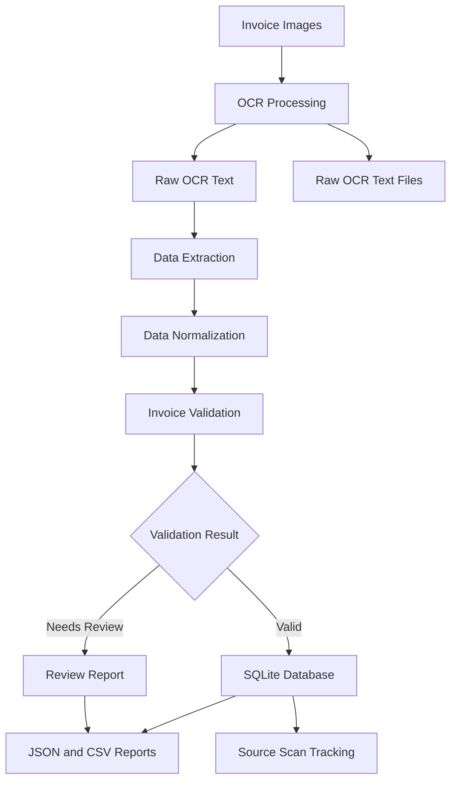

# 📄 Invoice OCR Validator

### Automated Invoice Data Extraction, Validation & Duplicate Detection Using Python

<p align="center">
  <strong>Turning Invoice Images into Structured, Validated Data</strong>
</p>

<p align="center">
  
  
  
  
  
  
</p>

---

## 📌 Overview

**Invoice OCR Validator** is a Python-based command-line application designed to automate invoice data extraction, validation, and storage.

The application uses **Tesseract OCR** to extract text from invoice images and processes the extracted information to identify important invoice fields, including invoice number, vendor name, invoice date, currency, subtotal, tax, and total amount.

It validates extracted information, detects duplicate invoices, maintains source-scan traceability, and stores validated invoice records in an SQLite database.

The system also identifies incomplete or ambiguous records and marks them for manual review instead of silently accepting uncertain information.

## ✨ Key Features

- 🖼️ **Invoice Image Processing** — Process multiple invoice images from an input directory.
- 🔍 **OCR-Based Text Extraction** — Extract invoice text using Tesseract OCR through Pytesseract.
- 📋 **Structured Data Extraction** — Identify invoice number, vendor, date, currency, subtotal, tax, and total.
- 🔄 **Data Normalization** — Normalize invoice dates and monetary values.
- ✅ **Invoice Validation** — Check required fields and verify subtotal + tax = total.
- ⚠️ **Manual Review Handling** — Flag missing, invalid, or ambiguous information with specific review reasons.
- 🔁 **Duplicate Detection** — Prevent duplicate invoice records using invoice identity constraints.
- 🗄️ **SQLite Database** — Persist validated invoices and maintain source-scan records.
- 🔐 **Source Traceability** — Track original image filenames, paths, OCR text paths, and SHA-256 hashes.
- 📊 **JSON & CSV Reports** — Generate structured extraction reports and review reports.
- 🔄 **Idempotent Processing** — Support repeated imports without creating duplicate invoice records.
- 🧪 **Automated Testing** — Test validation, duplicate handling, incomplete inputs, and processing behaviour.

## 🏗️ System Architecture

The application follows a modular Python architecture with separate components for OCR processing, data extraction, validation, database operations, and reporting.



### 1. Input Layer

Responsible for accepting invoice images.

**Supported workflow:**
- Read invoice images from the input directory.
- Process multiple files in one execution.
- Handle individual image-processing errors without stopping the entire batch.

### 2. OCR Processing Layer

**Technology:** Tesseract OCR, Pytesseract, Pillow

Responsible for:
- Reading invoice images.
- Extracting text using Tesseract OCR.
- Saving raw OCR output as text files.
- Maintaining a link between source images and extracted text.

### 3. Data Extraction Layer

**Module:** `extractor.py`

Responsible for:
- Extracting invoice numbers and vendor names.
- Identifying invoice dates and currency.
- Extracting subtotal, tax, and total amounts.
- Normalizing date and monetary formats.
- Using Decimal for accurate monetary calculations.

### 4. Validation Layer

**Module:** `validator.py`

Responsible for:
- Checking required invoice fields.
- Validating supported currency values.
- Checking subtotal and tax calculations against the total.
- Identifying incomplete or ambiguous information.
- Assigning validation status and review reasons.

### 5. Database Layer

**Module:** `db.py`

**Database:** SQLite

Responsible for:
- Storing validated invoice records.
- Preventing duplicate invoice entries.
- Maintaining source-scan traceability.
- Handling repeated imports through database conflict handling.

### 6. Reporting Layer

Generates structured output files:

| Output | Purpose |
|---|---|
| `extracted_records.json` | Extracted invoice records and validation results |
| `extracted_records.csv` | Tabular invoice extraction results |
| `needs_review.json` | Incomplete or invalid records with review reasons |
| `raw_ocr/` | Original OCR text extracted from each image |

## 🛠️ Tech Stack

| Technology | Purpose |
|---|---|
| Python | Core application development |
| Tesseract OCR | Optical character recognition |
| Pytesseract | Python integration with Tesseract |
| Pillow | Image loading and processing |
| Regular Expressions | Invoice field extraction |
| Decimal | Accurate monetary calculations |
| SQLite | Invoice and source-scan storage |
| JSON | Structured extraction and review reports |
| CSV | Tabular output generation |
| Pytest | Automated testing |

## 📁 Project Structure

```text
invoice-ocr-validator/
│
├── database/
│   └── schema.sql
│
├── input/
│   ├── invoice-101.png
│   ├── invoice-101-copy.png
│   ├── invoice-102.png
│   └── invoice-103-review.png
│
├── output/
│   ├── extracted_records.csv
│   ├── extracted_records.json
│   ├── needs_review.json
│   │
│   └── raw_ocr/
│       ├── invoice-101.txt
│       ├── invoice-101-copy.txt
│       ├── invoice-102.txt
│       └── invoice-103-review.txt
│
├── src/
│   ├── __init__.py
│   ├── main.py
│   ├── extractor.py
│   ├── validator.py
│   └── db.py
│
├── tests/
│   └── test_pipeline.py
│
├── invoices.sqlite3
├── requirements.txt
├── README.md
└── .gitignore
```

## 🚀 Getting Started

Follow these steps to install and run the application locally.

### Prerequisites

- Python 3.x
- pip package manager
- Tesseract OCR installed on your system
- Git (optional)

### 1. Clone the Repository

```bash
git clone <YOUR_REPOSITORY_URL>
cd invoice-ocr-validator
```

### 2. Create a Virtual Environment

**Windows:**

```bash
python -m venv venv
venv\Scripts\activate
```

**Linux / macOS:**

```bash
python3 -m venv venv
source venv/bin/activate
```

### 3. Install Python Dependencies

```bash
python -m pip install --upgrade pip
pip install -r requirements.txt
```

### 4. Install Tesseract OCR

Tesseract is an external OCR engine and must be installed separately from Python dependencies.

**Windows:**

Download and install Tesseract OCR, then ensure its installation directory is added to the system PATH.

Verify installation:

```bash
tesseract --version
```

**Linux (Ubuntu/Debian):**

```bash
sudo apt update
sudo apt install tesseract-ocr
```

**macOS:**

```bash
brew install tesseract
```

### 5. Run the Application

Place invoice images inside the `input/` directory.

Execute:

```bash
python -m src.main --input input --output output --db invoices.sqlite3
```

The application processes the available invoice images and generates extraction reports, review reports, raw OCR text files, and database records.

### 6. Run Automated Tests

```bash
python -m pytest -q
```

## 🗄️ Database Design

The application uses **SQLite** with two primary tables.

### 1. `invoices`

Stores unique validated invoice records.

Important fields:
- Invoice ID
- Invoice number
- Vendor name
- Normalized vendor name
- Invoice date
- Currency
- Subtotal
- Tax
- Total

A unique constraint on invoice number and normalized vendor name helps prevent duplicate invoice records.

### 2. `source_scans`

Maintains traceability for processed invoice images.

Important fields:
- Source filename
- Source path
- SHA-256 hash
- OCR text path
- Import status
- Review reasons
- Associated invoice ID

This design allows multiple source scans to reference the same invoice record while preserving individual scan information.

## 🧪 Testing

The project includes automated tests using Pytest.

The test suite covers:

- Successful invoice validation.
- Duplicate invoice handling.
- Repeated import and idempotency.
- Incomplete and ambiguous invoice information.
- Date and monetary normalization.
- Failed image handling.
- Fixture-based invoice extraction.

Run the test suite:

```bash
python -m pytest -q
```

## 📊 Sample Processing Results

The supplied demonstration dataset contains four invoice images.

| Metric | Result |
|---|---:|
| Total source images | 4 |
| Valid source records | 3 |
| Records requiring review | 1 |
| Unique invoice records | 2 |
| Source scans tracked | 4 |

**Duplicate handling:** Two scans of invoice TNM-101 are associated with the same database invoice record while both source scans remain independently traceable.

**Manual review:** Invoice TNM-103 is flagged because its date is missing and the subtotal, tax, and total values do not satisfy the validation check.

## ⚠️ Current Limitations

- OCR accuracy depends on image quality, text clarity, and invoice layout.
- The extraction logic is based on predefined patterns and may require adaptation for unfamiliar invoice formats.
- Ambiguous values are flagged for manual review rather than automatically inferred.
- Tesseract OCR must be installed separately on the host machine.
- The application currently uses SQLite for local persistence rather than a centralized database service.
- The command-line interface is designed for local processing and does not currently provide a web-based dashboard.

## 🔮 Future Improvements

- Support additional invoice layouts and document formats.
- Improve OCR accuracy through image preprocessing.
- Introduce configurable vendor-specific extraction rules.
- Add more comprehensive validation and reconciliation checks.
- Support additional database backends such as PostgreSQL or MySQL.
- Add a web-based interface for invoice review and approval.
- Implement more advanced duplicate detection.
- Improve logging, monitoring, and error reporting.

## 🔒 Data Handling & Reliability

- Raw OCR text is retained for traceability.
- Original source filenames and scan information are recorded.
- SHA-256 hashes help identify source files.
- Invalid or uncertain invoice records are flagged for manual review.
- Decimal arithmetic is used to avoid floating-point precision issues in financial calculations.
- Repeated processing is designed to avoid duplicate invoice records.

## 👨‍💻 Author

**Farhan Khan**

Junior Python Developer Candidate

Developed as part of the **The Night Marketer – Junior Python Developer Practical Screening Task**.

---

<p align="center">
  <strong>Invoice OCR Validator</strong><br/>
  <sub>Automated Extraction • Reliable Validation • Duplicate Detection • Traceable Storage</sub>
</p>
